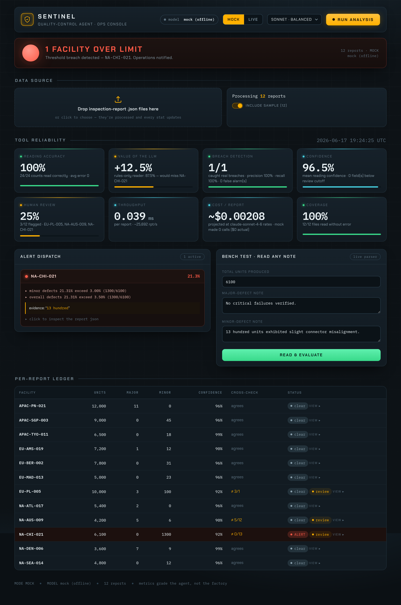

# Quality-Control Pipeline (mini-agent)

An automated pipeline that reads manufacturing **inspection-report JSONs**, uses an
**LLM to extract major/minor defect counts from free-text audit notes**, applies the
defect-threshold rules, raises a (stubbed) **e-mail alert** when a facility breaches a
limit, and — the part that matters most — **measures how well the tool itself reads,
classifies, and decides**, in language a non-technical operations reader can act on.

**▶ Live demo:** **https://mini-agent-qc.vercel.app** — open it and the offline analysis runs on load (free, no setup). Or run it locally (below).

### What this demonstrates (mapped to the brief)

| What you're looking for | Where to see it |
|---|---|
| Explore & understand unfamiliar data | the inspection-report schema and the free-text extraction problem (`qc_pipeline/loader.py`; step 2 below) |
| Data extraction with modern techniques | LLM **structured-output** extraction, robust to unseen phrasing (`qc_pipeline/extraction/llm_extractor.py`) |
| Clean, readable, testable code | one pluggable `Extractor` interface, a pure (I/O-free) rules engine, **86 tests** (`tests/`) |
| Explainability to non-technical audiences | the plain-language tool-quality summary (below) + `report/main.pdf` §3 |
| Logical problem-solving | the "13 hundred" → why-an-LLM → cross-check → measure-the-tool arc (`report/main.pdf` §4) |

> The full write-up (design, the natural-language extraction problem, and the
> tool-quality metrics explained for a non-technical audience) is in
> **`report/main.pdf`**. This README is just how to run it.

## Quickstart (offline, no API key, $0)

```bash
pip install -r requirements.txt        # pydantic (pipeline) · fastapi/uvicorn (dashboard) · anthropic (live)
python -m qc_pipeline --mode mock      # deterministic offline run
python -m pytest -q                    # full test suite
```

The mock run prints the alert(s) raised and a plain-language tool-quality summary, and
writes machine-readable metrics to `reports/results.json`.

## Dashboard (web console)

A one-command operations console wraps the whole pipeline:

```bash
pip install -r requirements.txt
python -m webapp            # then open http://127.0.0.1:8000
```

It runs the pipeline live (mock or live mode), and shows the alert state, the
tool-quality metrics as instrument readouts, the alert dispatch (with the audit-note
evidence behind each breach), the per-report ledger, and an interactive **bench test** —
type any audit note and watch the agent read the count, score its confidence, and decide.



## Live mode (real Anthropic extraction)

```bash
cp .env.example .env          # then put your key in ANTHROPIC_API_KEY
python -m qc_pipeline --mode live --tier balanced   # cheap=Haiku · balanced=Sonnet · max=Opus
```

`--mode live` is the only path that needs a key; everything else runs fully offline. The
live extractor is a drop-in `Extractor` — see "Design" below.

## What it does, step by step

1. **Load** every `*.json` in `data/inspection_reports/` (`qc_pipeline/loader.py`).
2. **Extract** major/minor defect counts from the free-text notes
   (`qc_pipeline/extraction/`). The notes phrase counts in wildly different ways
   (`"13 hundred units"` = 1300, `"half a dozen"` = 6, `"None"` = 0), which is exactly
   why an LLM beats a regex.
3. **Cross-check** every reading against an independent, deliberately-naive rule-based
   reader. Disagreement → the report is flagged for a human.
4. **Decide** via the threshold rules (`qc_pipeline/rules.py`): alert if major > 1%,
   minor > 3%, or overall > 3.5% of production.
5. **Alert** the stakeholders with a plain-language e-mail (`qc_pipeline/alerting.py`,
   stubbed — prints/logs instead of sending).
6. **Measure the tool** (`qc_pipeline/metrics/`): reading accuracy vs a hand-labelled
   golden set, the value the LLM adds over the naive baseline, alert precision/recall,
   confidence, human-review rate, latency, cost, and coverage → `reports/results.json`.

## Design

- **Pluggable extractors** behind one interface (`extraction/base.py`):
  `MockExtractor` (deterministic, offline — backs every test and the default run),
  `LLMExtractor` (Anthropic structured output via `messages.parse`), and a deliberately
  naive `NaiveBaselineExtractor` used only as a cross-check.
- The offline mock is **not** a lookup table of the sample answers — it runs the same
  robust natural-language parser (`extraction/number_words.py`) the LLM is prompted to
  emulate, so it generalises to unseen wording.
- The metrics evaluate the **agent**, never the manufacturing defect rates.
- **Extraction cache** — live reads are hashed by (model + audit-note content) and
  persisted to `~/.cache/qc_pipeline/`, so re-running the same reports with the same
  model costs **zero tokens** (editing a note changes the hash → it re-extracts).
  Inspect via `GET /api/cache`; clear from the dashboard.

## Layout

```
qc_pipeline/          loader · rules · alerting · pipeline · __main__
  extraction/         schema · number_words · base · mock · llm · baseline
  metrics/            evaluation · golden (hand-verified ground truth)
webapp/               FastAPI server + single-page control-room dashboard
tests/                number-word traps · rule boundaries · loader · metrics · e2e
data/inspection_reports/   the provided sample (12 reports)
report/main.pdf       the full write-up
```
